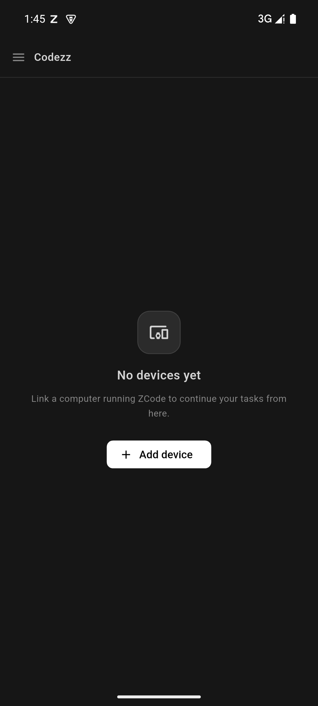
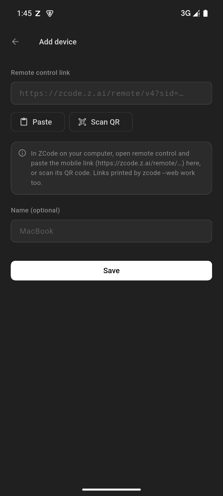
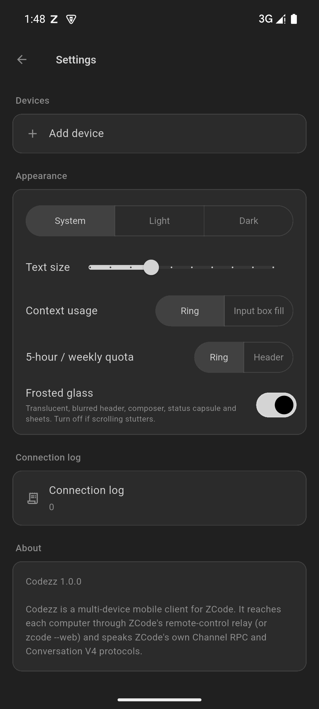

<div align="center">

# Codezz

**ZCode 的多设备移动客户端** — 把多台电脑上 ZCode 的远程控制链接加进来，在手机 / 平板上同时驱动它们的任务与对话。

| 主页 | 添加设备 | 设置 |
| --- | --- | --- |
|  |  |  |

[](https://flutter.dev)
[](https://github.com/binb1nwu/Codezz/actions/workflows/build-apk.yml)
[](../../releases)
[](LICENSE)

</div>

---

## 它是什么

ZCode 桌面端自带远程控制：它会给出一条手机连接链接（`https://zcode.z.ai/remote/v4?sid=…&hash=…&t=…&mid=…`），手机经由 ZCode 的云端中继连回这台电脑，不需要公网 IP，也不需要在同一局域网。ZCode 自己的远程网页一次只能控制一台电脑，在手机上也不够顺手。

Codezz 做两件事：

1. **多设备**：保存任意多条远程链接，所有设备在后台同时保持连接，一键切换，列表里实时显示每台设备的在线状态、延迟以及正在运行 / 等待确认的任务数。
2. **按 ZCode 重做的移动端**：直接说 ZCode 自己的协议（`@zcode/rpc` 的 Channel RPC + Conversation V4），界面沿用 ZCode 的设计系统（Zai Light / Zai Dark 语义色、`text-ui-*` 字号、圆角层级、「已工作 …」折叠、Composer 工具栏），手机上是单栏布局（任务列表、审查 / 终端各为一个完整页面，返回键回到对话），平板 / 桌面宽屏是侧栏 + 对话的分栏布局。

## 快速开始

1. 在电脑上的 ZCode 中打开远程控制，复制手机连接链接（或显示它的二维码）。
2. 在 Codezz 里：**添加设备** → 粘贴链接或扫码 → 保存。可以重复添加多台电脑。

远程链接过期或被撤销后，Codezz 会显示「链接已失效」，在电脑上复制新链接后点「更新链接」即可；同一台电脑（按 `mid` 识别）的新链接会替换旧链接，而不是新增一台设备。

也支持直连 `zcode --web`（适合在局域网或 VPN 内使用）：

```bash
zcode --web --host 0.0.0.0 --token "$(openssl rand -base64 24)"
# 把终端输出的 Network 链接 http://192.168.1.8:3030/?token=… 加到 Codezz
```

## 功能

- **设备**：远程控制链接（云端中继）与 `zcode --web` 直连链接均可，多设备并发在线、状态 / 延迟 / 活跃任务徽标、断线指数退避重连（1s → 15s）、回到前台时主动探活并立即重连、链接失效时提示更新；链接在 Android 上以 Keystore AES-GCM 加密保存。
- **任务列表**（与 ZCode 侧栏一致）：tasks-index 决定持久成员（任务 / 置顶 / 已归档 / 已删除 / 未读），sessions-index 提供实时状态（运行中、等待确认、出错）；搜索、置顶、归档、删除。
- **对话**：Conversation V4 快照 + 增量实时同步，流式正文与思考过程、工具调用（命令、文件 diff、输出）、子代理、时间线标记；每轮按 ZCode 的方式分成用户消息、「已工作 …」折叠区与最终回答；向上滚动按需加载更早的消息；复制、重试、编辑用户消息、点赞 / 点踩。
- **交互**：权限请求（允许 / 始终允许 / 拒绝 + 反馈）、AskUserQuestion 多题问答（含自动结束暂停）、普通输入请求，回答格式与 ZCode 完全一致。
- **Composer**：新建任务（`createSession` + 首条消息）、后续消息、运行中排队、暂停队列时的「清空 / 保留队列」选择、停止、模式（变更前确认 / 自动编辑 / 计划模式 / 完全访问）、模型与思考档位切换、队列管理、后台任务。
  - 「+」添加上下文：附件（图片 / 视频 / PDF 原样上传，文本文件截断到 64K 字符，最多 8 个，分块上传到会话）、目标（`/goal`，仅新任务）、引用插件 / 工作区文件 / 其他会话。
  - 用量环：剩余量同心圆（外圈每周额度、中圈 5 小时额度或 Start 套餐今日余额、内圈上下文），点开为上下文容量（来源占比、缓存命中率）与编程套餐剩余额度（5 小时 / 每周 / 工具调用 / ZCode MCP，Start 套餐显示今日余额）。设置里可改为把整个输入框当作上下文占用条，5 小时 / 每周额度也可改为显示在顶部设备名右侧（小进度条，点击打开同一页面）。可开启毛玻璃效果（顶栏、输入框、状态胶囊和弹出面板半透明模糊，对话在其下方滚动）。
- **状态胶囊**（对话区右上角）：当前待办 / 目标 / Git 更改 / 后台运行，点击展开为状态面板，可暂停目标、停止后台任务、打开审查；对话区右下角有「滚动到底部」按钮。
- **审查 / 终端页面**（对话页右上角）：审查（按未暂存 / 已暂存 / 全部分支更改查看 Git 改动，展开单个文件的 diff）与终端（桌面端 PTY，可开多个标签，附 Esc / Tab / Ctrl / 方向键 / 复制粘贴按键栏）；返回对话后终端保持运行。点 Read 工具行或回复里的本地文件链接会在这里打开文件预览（代码带行号、Markdown 渲染、图片缩放、视频 / 音频播放，PDF / PPT / Word / Excel 与网页一样在应用内渲染）。
- **任务通知**：运行中的任务在通知栏常驻进度（同状态胶囊），完成 / 出错 / 需要回答时提醒，点通知打开对应任务；重新打开应用回到上次的任务。
- **其他**：中英双语、浅色 / 深色 / 跟随系统、字体大小、连接日志。

## 协议栈

```
配对链接   https://zcode.z.ai/remote/v4?sid&hash&t&mid
   ↓
Relay WebSocket    wss://<relay>/ws?mid=…   （JSON 文本帧，HMAC 认证）
   ↓
rpc-frame 传输     zcode_type: rpc-frame / rpc-frame-ack （分片 + CRC32）
   ↓
ChannelClient RPC  二进制消息 [type,id,channel,name]+args （promise / event）
   ↓
V4 Topic 同步 + 命令   subscribe…V4 / sendConversationCommandV4
```

- **认证**：手机以 `terminal` 角色连中继，`auth_init` → `auth_challenge{nonce}` → `auth_response{proof}` → `auth_ack`，其中 `proof = base64url(HMAC-SHA256(key=hash, "nonce|role|sid"))`——链接里的 `hash` 只作签名密钥、从不外发。
- **同步**：每个会话话题（会话索引、对话）是独立的订阅；快照帧整体替换状态，增量帧只在 `fromSeq` 与本地水位线衔接时应用，断档或校验失败就带 `{logEpoch, seq}` 续传，不重发全量。
- **命令**：`sendConversationCommandV4` 信封用 UUID v7 做幂等，服务端按乐观并发裁决（accepted / rejected / stale / duplicate / noop / failed），`stale` 带回最新修订号供重试一次。

## 架构

```
lib/
├── core/                         与 UI 无关、可单测
│   ├── rpc/                      @zcode/rpc 的 Dart 移植
│   │   ├── serialization.dart    值编解码（tag + VQL，JSON 回退，嵌套字节标记）
│   │   ├── socket_protocol.dart  13 字节帧头的 SocketProtocol 分帧
│   │   └── channel_client.dart   ChannelClient：call / listen / cancel / dispose
│   ├── connection/               重连 / 退避 / 探活的公共基类，中继连接与 Web 直连两种实现
│   ├── relay/                    ZCode 远程控制中继
│   │   ├── relay_socket.dart     terminal 角色认证（HMAC proof）、配对状态、心跳、请求 / 响应
│   │   └── rpc_frame_transport.dart  workspace bridge 上的 rpc-frame 分片、CRC32、ACK、重放去重
│   ├── link/device_link.dart     远程链接（sid / hash / t / mid）与 `zcode --web` 链接解析
│   ├── zcode/                    服务门面（zcode-agent / zcode-task / model-selection）
│   └── v4/                       Conversation V4
│       ├── wire_assembler.dart   物理帧 → 逻辑帧（分片、CRC32、序号去重、超时）
│       ├── topic_router.dart     按 topic 路由；ACK 前到达的初始帧先暂存
│       ├── synced_topic.dart     快照 / 增量水位、断档 resync、重连后带 base 续订
│       ├── sessions_index_store.dart
│       └── conversation_store.dart  apply.ts 的增量代数 + V4 命令信封
├── state/                        设备注册表、每设备会话、任务列表、模型目录
└── ui/                           按 ZCode 设计系统重做的界面
```

中继连接流程与 ZCode 远程网页一致：`auth_init` → `auth_challenge` → `auth_response(proof)` → `matched` → `bootstrap-request`（工作区列表）→ `workspace-bridge-open` → 在 `rpc-frame` 中承载 Channel RPC。中继 socket 在 bridge 重开时复用，只有 socket 断开才重新认证；桌面端只保留一个移动端 bridge，因此 bridge 跟随当前工作区（本地工作区共用同一个 bridge）。流式增量按微任务合并为一次重绘，未变化的对话轮复用同一个 Widget 实例，只有正在输出的那一轮会重建。

## 开发

```bash
flutter pub get
flutter analyze
flutter test                       # 协议、中继、存储、链接解析、分组、启动流程

# 端到端（只读）：经远程控制中继连接真实桌面，不会创建或修改任务
CODEZZ_RELAY_LINK='https://zcode.z.ai/remote/v4?sid=…&hash=…&t=…&mid=…' flutter test test/live_relay_test.dart

# 端到端：对一台真实的 ZCode Web 服务运行（需要已配置模型）
CODEZZ_TEST_LINK='http://127.0.0.1:3030/?token=…' flutter test test/live_server_test.dart

flutter run                        # Android
flutter build apk --split-per-abi
```

Web 构建可用于调试。直连 `zcode --web` 时浏览器会拦截跨域的 `/api/server-info`（ZCode 服务不带 CORS 头），需要与 ZCode 服务同源部署；远程链接不受影响。

发布构建打 `v*` tag 触发 GitHub Actions（`build-apk.yml`），从仓库 Secrets 读取签名配置；签名密钥只保存在本地 `android/key.properties` 与 CI Secrets 中，不入库。

## 安全提示

- 远程链接中的 `sid` / `hash` 与 `zcode --web` 链接中的 `token` 都等同于这台电脑上 ZCode 的完全访问权限，切勿分享或提交到代码仓库。Codezz 在 Android 上以 Keystore 加密保存链接，日志中只显示设备名与主机名。
- `zcode --web` 默认是明文 HTTP，只建议在可信局域网或 VPN（如 Tailscale）内使用；跨公网请放在 HTTPS 反向代理之后（Codezz 支持 `https://…/子路径/?token=…`）。

## 致谢

本项目始于 [HumanAILoop/Zemote](https://github.com/HumanAILoop/zemote)（MIT），在 ZCode 的 Web 协议之上重写并扩展了多设备支持，感谢原项目作者的出色工作。

## License

[MIT](LICENSE)
